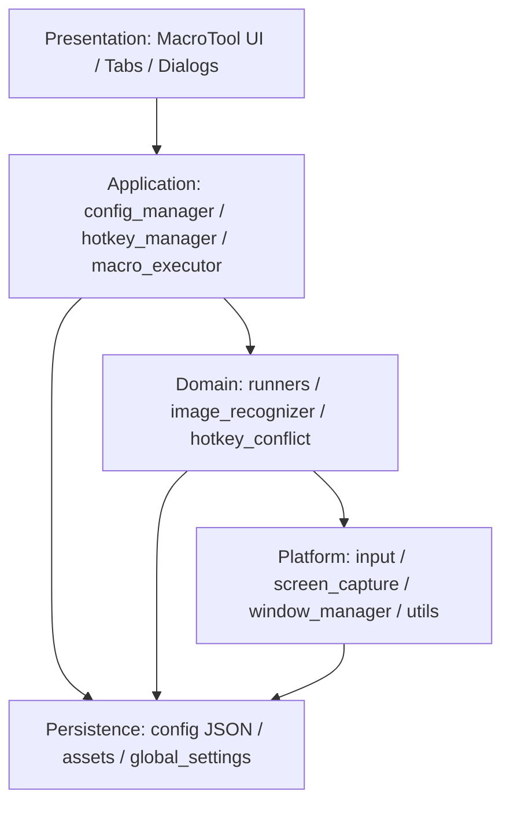
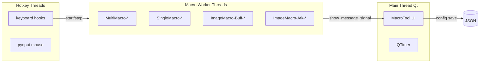
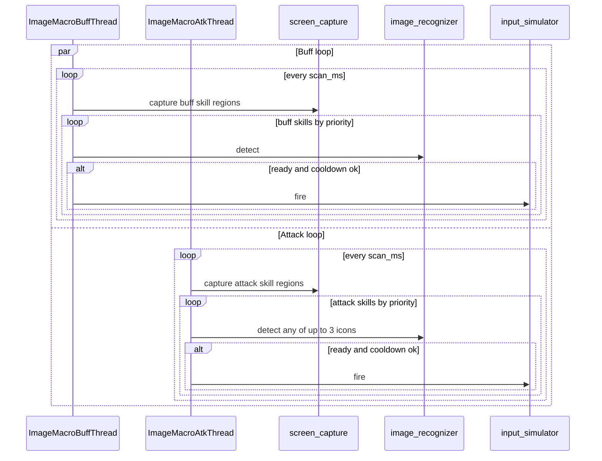

# TL_Macro 开发人员设计文档

> 版本：v1.7.0 · 面向 Python/PyQt 开发者 · 最后更新：2026-11

---

## 目录

1. [项目概述与技术栈](#1-项目概述与技术栈)
2. [系统架构与分层](#2-系统架构与分层)
3. [启动与生命周期](#3-启动与生命周期)
4. [配置与数据模型](#4-配置与数据模型)
5. [核心子系统](#5-核心子系统)
6. [线程与并发模型](#6-线程与并发模型)
7. [三种宏执行设计](#7-三种宏执行设计)
8. [图像宏专项设计](#8-图像宏专项设计)
9. [热键与冲突检测](#9-热键与冲突检测)
10. [构建与依赖](#10-构建与依赖)
11. [测试策略](#11-测试策略)
12. [扩展与修改指南](#12-扩展与修改指南)

---

## 1. 项目概述与技术栈

**TL_Macro** 是 Windows 桌面游戏宏辅助工具，当前版本 **v1.7.0**（见 `version.py`）。

### 1.1 功能

| 宏类型 | 说明 |
|--------|------|
| **多键宏** | 按序列模拟键盘/鼠标，支持组合键（`Ctrl&A`） |
| **单键宏** | 单键循环连发，可配置按下/间隔时长 |
| **图像宏** | 截屏 + OpenCV 模板匹配，按技能图标/Buff 状态自动施放按键 |

### 1.2 平台约束

- **仅 Windows**（Win32 API、SendInput、Desktop Duplication）
- **管理员权限**（UAC 提权，全局热键与输入模拟需要）
- **单实例运行**（命名互斥量，见 `utils.ensure_single_instance`）
- 关闭窗口（X）**最小化到托盘**，宏可继续在后台运行

### 1.3 技术栈

| 层 | 技术 |
|----|------|
| UI | PyQt5 |
| 输入模拟 | Win32 `SendInput`（ctypes，`input.py`） |
| 全局热键 | `keyboard`（键盘 hook）+ `pynput`（鼠标） |
| 图像识别 | OpenCV `matchTemplate` + NumPy |
| 截屏 | `mss`（GDI）/ `bettercam`（DXGI Desktop Duplication） |
| 配置持久化 | JSON 文件 |
| 日志 | 标准库 `logging`，按日滚动文件 |
| 打包 | PyInstaller onedir（`TL_Macro.spec`） |

### 1.4 代码布局

应用源码为**扁平根目录**布局：约 **35** 个业务 `.py` 模块与 `app.py` 同级，无 `src/` 包。测试在 `tests/` 目录。

---

## 2. 系统架构与分层

### 2.1 分层图

自上而下依赖：上层调用下层；持久化被应用层与领域层读写。



### 2.2 依赖方向（简图）

```
app.py
 ├── UI: home, about, global_settings_tab, *_macro_tab, dialogs
 ├── config_manager → hotkey_conflict
 ├── hotkey_manager → macro_executor
 │                      ├── multi_macro_runner  ─┐
 │                      ├── single_macro_runner ├→ window_manager, screen_capture, input
 │                      └── image_macro_runner  ─┘→ image_recognizer → screen_capture → global_settings
 ├── global_settings → utils
 └── process_history → window_manager
```

### 2.3 模块清单

#### 入口与编排

| 文件 | 职责 |
|------|------|
| `app.py` | 主窗口 `MacroTool`；配置 CRUD、启停、托盘、定时器 |
| `version.py` | `APP_VERSION`, `APP_TITLE` |

#### 配置

| 文件 | 职责 |
|------|------|
| `config_defaults.py` | 默认配置工厂、`merge_loaded_config` |
| `config_manager.py` | JSON 读写、启用列表、冲突检测门面 |
| `hotkey_conflict.py` | 纯函数热键冲突逻辑（无 Qt） |
| `global_settings.py` | 全局参数（焦点 / 扫描间隔 / 截屏后端 / 日志级别） |
| `asset_manager.py` | 图像宏 PNG 路径（多形态图标 / Buff / 区域预览）与生命周期 |

#### 宏执行

| 文件 | 职责 |
|------|------|
| `macro_executor.py` | 门面：组合三种 Runner + 停止全部 / 状态恢复 |
| `macro_types.py` | `MacroState`, `MacroType`, `MacroInfo` |
| `multi_macro_runner.py` | 多键宏 Mixin |
| `single_macro_runner.py` | 单键宏 Mixin |
| `image_macro_runner.py` | 图像宏 Mixin（Buff/攻击双线程，`_image_fire_lock` 串行发键） |
| `hotkey_manager.py` | 全局热键监听 → 启停宏 |

#### 图像识别

| 文件 | 职责 |
|------|------|
| `image_recognizer.py` | 模板匹配、Buff 门控、区域聚类、技能状态机 |
| `screen_capture.py` | MSS / DXGI 双后端区域截屏 |
| `screenshot_overlay.py` | 全屏框选 overlay（技能配置用） |

#### 平台

| 文件 | 职责 |
|------|------|
| `input.py` | `SendInput`、高精度睡眠、`input_simulator` 单例 |
| `key_mapping.py` | 显示名 ↔ 虚拟键码、鼠标键判断 |
| `window_manager.py` | 前台进程焦点门控（单例 `window_focus_manager`） |
| `utils.py` | 路径、UAC、单实例、内存清理、模式文案 |
| `logger.py` | 按日滚动日志、`get_logger()` 单例 |
| `process_history.py` | 最近前台进程历史（全局设置 UI 用） |

#### UI 标签页与对话框

| 文件 | 职责 |
|------|------|
| `home.py` | 主页仪表盘 |
| `about.py` | 关于页 |
| `global_settings_tab.py` | 全局参数 UI，写入 `window_focus_manager` |
| `macro_tab_base.py` | 宏 Tab 基类（热键录制、冲突检查、`configChanged`） |
| `multi_macro_tab.py` | 多键宏配置 UI |
| `single_macro_tab.py` | 单键宏配置 UI |
| `image_macro_tab.py` | 图像宏配置 UI |
| `image_skill_dialog.py` | 技能编辑对话框、测试识别 |
| `dialogs.py` | 新建 / 重命名配置 |
| `hotkey.py` | 热键录制对话框 |
| `keyboard_selector.py` | pywebview 可视化选键 |
| `macro_sequence_recorder.py` | 宏序列录制 |

---

## 3. 启动与生命周期

### 3.1 `main()` 流程

入口：`app.py` 底部 `main()`。

```
get_logger()
  → request_admin_privileges()      # 非管理员则 ShellExecute runas 重启
  → ensure_single_instance()        # 已运行则退出
  → load_global_settings()          # 载入 config/global_settings.json 到内存缓存
  → QApplication + MacroTool()
  → window.show()
  → app.exec_()
```

### 3.2 `MacroTool` 构造顺序

1. 创建 `ConfigManager`、`MacroExecutor`、`HotkeyManager`
2. `macro_executor.show_message_signal` → `show_message`（跨线程弹窗）
3. 定时器：
   - **状态恢复**：启动 3s 后，每 2s 调用 `recover_inconsistent_states`
   - **内存清理**：每 2min 调用 `cleanup_memory`
   - **配置保存防抖**：单次 `QTimer`，500ms（见 `_save_config_timer.start(500)`）
4. `init_ui()`：配置列表 + 6 个 Tab（主页、多键、单键、图像、全局参数、关于）
5. `config_manager.create_config_dir()` / `load_enabled_configs()` / `load_configs()`
6. `refresh_enabled_configs_data()`；加载首个启用或未启用配置
7. `hotkey_manager.start_hotkey_listener()`
8. `process_history_monitor.start()`

宏 Tab 通过依赖注入获取回调（`app.py`）：

```python
tab_deps = dict(
    has_config_fn=self.has_config,
    conflict_checker=self.check_hotkey_conflict,
)
```

### 3.3 关闭与退出

| 操作 | 行为 |
|------|------|
| 点击窗口 X | `hide()` 到系统托盘，**宏与热键继续** |
| 托盘「显示窗口」 | `show()` + 置前 |
| 托盘「退出程序」 | 保存配置、`stop_all_macros`、`stop_hotkey_listener`、退出 Qt |

---

## 4. 配置与数据模型

### 4.1 运行时目录布局

路径基准：`get_app_base_dir()`（开发时为项目根，打包后为 exe 所在目录）。

```
{app_base}/
  config/
    {profile}.json              # 单配置（多/单/图像宏合一）
    enabled_configs.json        # 已启用配置名列表 ["cfg1", "cfg2"]
    global_settings.json        # 全局参数
    assets/{profile}/
      skills/{skill_id}_icon_0.png   # 多形态：_icon_0 / _icon_1 / _icon_2
      buffs/{skill_id}_buff.png
      buff_regions/{skill_id}_region.png   # Buff 区域预览（配置 UI）
  log/
    app_YYYY-MM-DD.log
  resources/
    tl.ico                      # 应用图标（打包用）
```

### 4.2 单配置 JSON 结构

由 `config_defaults.make_default_config` 定义默认值，加载时 `merge_loaded_config` 浅合并。

```json
{
  "hotkey": "",
  "macros": [],
  "mode": 2,
  "single_key_macro": {
    "hotkey": "",
    "press_time": 15,
    "interval": 20,
    "mode": 1
  },
  "image_macro": {
    "hotkey": "",
    "mode": 1,
    "skills": []
  }
}
```

#### 模式枚举（`mode`）

| 宏类型 | 值 | 含义 |
|--------|-----|------|
| 多键宏 | 1 | 循环直到再次按下热键停止 |
| 多键宏 | 2 | 执行一次序列 |
| 多键宏 | 3 | 按住热键循环，松开停止 |
| 单键宏 | 1 | 同多键宏模式 1 |
| 单键宏 | 2 | 同多键宏模式 3（按住循环、松开停） |
| 图像宏 | 1 | 按热键 toggle 开始/停止扫描 |
| 图像宏 | 3 | 按住开始扫描，松开停止 |

#### 图像宏技能对象（`skills[]`）

加载/规范化见 `image_recognizer.normalize_image_skill`；新建技能默认值由 `image_skill_dialog` 与识别常量（如 `DEFAULT_RECOVERY_MS` / `DEFAULT_EXECUTE_INTERVAL_MS` = **100**）共同给出。资源路径见 `asset_manager`。

```json
{
  "id": "a1b2c3d4",
  "name": "技能名",
  "key": "1",
  "skill_kind": "attack",
  "press_time": 50,
  "repeat_count": 1,
  "repeat_interval": 100,
  "recovery_ms": 100,
  "execute_interval_ms": 100,
  "ensure_press": false,
  "ensure_press_timeout_ms": 500,
  "ensure_press_retries": 3,
  "priority": null,
  "recognition": {
    "confidence": 0.85,
    "position_tolerance": 30,
    "search_margin": 80,
    "brightness_threshold": 80
  },
  "icon": {
    "path": "assets/{profile}/skills/{id}_icon_0.png",
    "x": 100, "y": 200, "width": 32, "height": 32
  },
  "icons": [
    { "path": "assets/{profile}/skills/{id}_icon_0.png", "x": 100, "y": 200, "width": 32, "height": 32 }
  ],
  "precondition": {
    "enabled": false,
    "trigger_mode": "present",
    "name": "",
    "wait_after_buff_ms": 300,
    "buff_region": { "x": 0, "y": 0, "width": 0, "height": 0 },
    "buff_icon": {
      "path": "",
      "width": 0, "height": 0,
      "x": 0, "y": 0
    },
    "recognition": { "confidence": 0.85 }
  }
}
```

- `skill_kind`: `"attack"`（默认）| `"buff"`；UI 分 Tab，执行时双线程并行
- `icons[]`：最多 3 个技能图标，任一匹配且亮起即可；`icon` 镜像第一张（兼容旧配置）；路径多为 `{id}_icon_{0|1|2}.png`
- `recovery_ms` / `execute_interval_ms`：默认各 **100**；取较大值作为该技能自身冷却（不 sleep 堵整轮）
- `ensure_press`：发键后需观察到图标变灰才算成功
- `priority`：1–10，越大越优先；`null` 表示未设置（排在有 priority 的后面）；同类内比较；UI 侧可检测同类重复 priority
- `trigger_mode`: `"present"`（Buff 出现后等待）| `"absent"`（Buff 消失后触发）
- 旧版 `postcondition` 在加载时由 `normalize_skill_precondition` 迁移合并

### 4.3 全局设置

文件：`config/global_settings.json`，逻辑见 `global_settings.py`。

```json
{
  "global_mode": true,
  "processes": [],
  "scan_interval_ms": 50,
  "capture_backend": "mss",
  "log_level": "WARNING"
}
```

| 字段 | 说明 |
|------|------|
| `global_mode` | `true`：任意前台窗口可执行宏；`false`：仅 `processes` 内进程 |
| `processes` | 目标进程名列表，默认 `[]`，最多 5 个，不区分大小写 |
| `scan_interval_ms` | 图像宏扫描间隔，默认 50，钳制 30–500 ms |
| `capture_backend` | `"mss"`（GDI）或 `"dxgi"`（Desktop Duplication） |
| `log_level` | `"DEBUG"` / `"INFO"` / `"WARNING"` / `"ERROR"`，默认 `"WARNING"` |

修改全局参数后，`GlobalSettingsTab` 调用 `window_focus_manager.apply_settings` 即时生效；切换 `capture_backend` 时经 `save_settings` 触发 `screen_capture.on_backend_changed` 释放旧相机。

### 4.4 配置读写策略

- UI Tab 修改 → `configChanged` 信号 → `app.schedule_save_config` → **500ms 防抖** → `config_manager.save_config`
- 写入前 `sanitize_for_json` 将 NumPy 标量转为 Python 原生类型
- 启用/禁用配置：更新 `enabled_configs.json` + `refresh_enabled_configs_data` + `hotkey_manager.rebuild_hotkey_maps`
- 任意配置启用时，全局参数 Tab 设为只读（避免运行中改焦点规则）

---

## 5. 核心子系统

### 5.1 MacroExecutor（门面）

文件：`macro_executor.py`

```python
class MacroExecutor(
    QObject,
    MultiMacroRunnerMixin,
    SingleMacroRunnerMixin,
    ImageMacroRunnerMixin,
):
    show_message_signal = pyqtSignal(str, str)
```

| 职责 | 说明 |
|------|------|
| 宏实例字典 | `multi_macros` / `single_macros` / `image_macros` → `MacroInfo` |
| 并发限制 | `MAX_CONCURRENT_MACROS = 2` 分别作用于**多键字典**与**单键字典**（可同时约 2 多键 + 2 单键）；图像宏另计 `MAX_CONCURRENT_IMAGE_MACROS = 1` |
| 状态 | `MacroState` 枚举 + 每实例 `RLock`；图像宏可用 `MacroInfo.threads` / `any_worker_alive()` |
| 停止全部 | `stop_all_macros()` |
| 状态恢复 | `recover_inconsistent_states()`：工作线程已死但状态仍为 RUNNING 时修复，并清理对应热键按下状态 |
| 跨线程 UI | 仅通过 `show_message_signal` 通知主线程 |

类型定义在 `macro_types.py`，对外可从 `macro_executor` 导入 `MacroInfo`, `MacroState`, `MacroType`。

### 5.2 HotkeyManager

文件：`hotkey_manager.py`

- **键盘**：`keyboard` 库注册 press/release hook（事件驱动，低 CPU）
- **鼠标**：`pynput` 独立监听线程
- **映射表**（仅已启用配置）：
  - `keyboard_hotkey_map`: `{key → (config_name, type, display_hotkey, mode)}`
  - `mouse_hotkey_map`: `{button → (config_name, type, mode)}`
- **状态跟踪**：`multi_hotkey_pressed`、`image_hotkey_pressed` 等，配合 mode 1/3
- **图像宏**：`on_image_hotkey_triggered` — 运行中则 stop，否则 start

配置变更时 `app._rebuild_hotkey_maps()` → `rebuild_hotkey_maps()` + `_map_update_event` 通知监听线程刷新 hook。

### 5.3 WindowFocusManager

文件：`window_manager.py`，单例 `window_focus_manager`。

- `GetForegroundWindow` → `GetWindowThreadProcessId` → 进程名
- 查询结果缓存 TTL **50ms**
- `is_target_window_active()`：`global_mode` 或进程名在 `target_processes` 内
- 所有 Runner 在**启动前**与**循环内**检查；失焦则 break/return

### 5.4 input_simulator

文件：`input.py`

| API | 用途 |
|-----|------|
| `send_key_event` / `send_mouse_event` | 底层 Win32 `SendInput` |
| `get_virtual_key` / `get_key_flags` | 与 `key_mapping` 配合 |
| `high_precision_sleep` | QPC 高精度等待，支持 `threading.Event` 中断 |
| `execute_macro_sequence` | 多键宏：遍历 macros 列表执行 |

发键细节：

- 普通键：虚拟键码（VK）+ 按下/抬起标志
- 扩展键（如方向键）：附加 `KEYEVENTF_EXTENDEDKEY`
- 右侧修饰键（RShift / RCtrl / RAlt / RWin 等）：扫描码 + `KEYEVENTF_SCANCODE`（必要时含扩展标志），避免左右侧识别错误
- 鼠标：`MOUSEEVENTF_*DOWN/UP`（含侧键 XBUTTON）

### 5.5 screen_capture

文件：`screen_capture.py`

| 后端 | 常量 | 实现 | 特点 |
|------|------|------|------|
| GDI | `BACKEND_MSS` | `mss` | 兼容性好；每次 `grab_region` 独立截屏 |
| DXGI | `BACKEND_DXGI` | `bettercam` + `comtypes` | Desktop Duplication；图像宏一轮一次 dup |

**图像宏 DXGI 一轮扫描：**

```
begin_capture_frame()   # dup 整帧到线程局部 dxgi_frame
  → grab_region() × N   # 从缓存帧切片（同线程）
end_capture_frame()     # 释放 dxgi_frame
```

DXGI 无新帧时 `begin_capture_frame()` 返回 `False`，该轮扫描跳过；图像宏循环可结合 `get_capture_backoff_sec` / `was_last_capture_round_skipped()` 做短暂退避，避免空转打满 CPU。

线程结束必须调用 `release_thread_capture()` 释放 MSS/DXGI 线程局部资源。

### 5.6 日志

- 单例 `get_logger()`，级别优先级：**环境变量 `TL_MACRO_LOG_LEVEL`** > **`config/global_settings.json` 的 `log_level`** > 默认 **WARNING**
- 全局参数页可切换级别，变更会持久化到 `global_settings.json`
- 文件：`log/app_{date}.log`；同时输出控制台
- 格式：`[时间] [级别] [文件名:行号] 消息`

| 级别 | 用途 |
|------|------|
| DEBUG | 热键映射、窗口焦点、截屏区域、识别分数、配置读写摘要 |
| INFO | 启动/退出、宏启停、配置启用/保存、技能提交成功 |
| WARNING | DXGI 失效、线程超时、截屏/IO 失败 |
| ERROR | 未捕获异常、宏执行崩溃 |

开发排查时在全局参数将级别设为 **DEBUG**，可串起配置→热键→宏→截屏→识别全链路。

---

## 6. 线程与并发模型



图像宏每个启用配置最多两条 worker（`MacroInfo.threads`：`ImageMacro-Buff-{config}` 与 `ImageMacro-Atk-{config}`），共享同一 `stop_event`；跨线程发键由 `MacroExecutor._image_fire_lock` 串行化。

### 6.1 线程安全规则

1. **Qt 控件仅主线程**访问；工作线程用 `pyqtSignal` 通知 UI
2. **截屏资源线程本地**（`threading.local` in `screen_capture`）
3. **MacroInfo.stop_event** 用于协作式停止；`stop_*_fast` 无锁仅 set Event（热键回调路径）
4. **图像宏 SkillRuntimeState**：仅在对应 `ImageMacro-*` 线程内读写（识别与发键同线程；无 fire_queue / fire_done 队列，用进程内锁串行 `SendInput`）
5. **global_lock**（`MacroExecutor`）：保护宏字典的增删与状态查询

---

## 7. 三种宏执行设计

### 7.1 多键宏（MultiMacroRunnerMixin）

文件：`multi_macro_runner.py`

```
热键 → start_multi_macro()
  → 校验：并发、焦点、macros 非空
  → Thread(_execute_multi_macro)
       mode 2: _execute_multi_macro_once
       mode 1/3: _execute_multi_macro_loop → execute_macro_sequence
  → finally: release_thread_capture(), MacroState → STOPPED
```

`stop_multi_macro` / `stop_multi_macro_fast`：设置 `stop_event`。

### 7.2 单键宏（SingleMacroRunnerMixin）

文件：`single_macro_runner.py`

循环：`按下 → press_time → 抬起 → interval`，直到 `stop_event` 或失焦。

UI 层拒绝鼠标键作为单键宏热键（`single_macro_tab.py`）。

### 7.3 图像宏（ImageMacroRunnerMixin）

详见 [第 8 节](#8-图像宏专项设计)。

---

## 8. 图像宏专项设计

文件：`image_macro_runner.py` + `image_recognizer.py`

### 8.1 Buff / 攻击双线程并行（无发键队列）



| 线程 | 名称 | 职责 |
|------|------|------|
| Buff | `ImageMacro-Buff-{config}` | 仅处理 `skill_kind=buff` |
| Attack | `ImageMacro-Atk-{config}` | 仅处理 `skill_kind=attack`（缺省） |

- 共享 `stop_event`；热键启停一个配置，内部最多两条工作线程
- **后摇不再 `sleep` 堵轮**：`recovery_ms` 与 `execute_interval_ms` 取较大值写入该技能 `cooldown_until`
- 同帧可连续检查多个技能；发键用进程内锁串行化 `SendInput`
- 可选 `ensure_press`：发键后等待图标变灰，超时可重试

### 8.2 单轮流程（每类线程各自）

1. 收集本类技能搜索矩形（最多 3 个技能图标 + 可选 Buff 区）
2. **`cluster_skill_rects`** 合并截屏；单组并集面积上限 `MAX_CAPTURE_GROUP_AREA`（480,000 px），过大则拆组
3. `begin_capture_frame()` → 各组 `grab_region` → `end_capture_frame()`；无新帧或捕获失败时可按 backoff 跳过本轮
4. 按 **`sort_candidates_by_priority`** 遍历：
   - Buff 门控 → 多图标 OR 识别 → `should_enqueue_skill`（含冷却 / 确保按下等待；命名保留 enqueue，实际为同步判定）
   - 应执行：在 `_image_fire_lock` 下 `_fire_skill_key` → `mark_skill_fired`（打冷却；可选 ensure）→ **立即下一技能**（不 sleep 后摇）

### 8.3 触发语义

| 场景 | 条件 | 防连发 / 间隔 |
|------|------|----------------|
| 默认 / present | 门控通过且任一图标 `is_ready`（**电平**） | `max(recovery_ms, execute_interval_ms)` |
| absent | Buff 门控通过且图标可见 | 冷却至少 500ms |
| 确保按下 | 发键后等变灰 | 超时重试 `ensure_press_retries` |

### 8.4 识别参数

**IconMatcher**（技能图标）：

- `cv2.TM_CCOEFF_NORMED`，阈值 `confidence`（默认 0.85）
- 匹配位置与锚点偏差 ≤ `position_tolerance`（默认 30px）
- 匹配区域平均亮度 ≥ `brightness_threshold`（默认 80）
- 搜索区：锚点 ± `search_margin`（默认 80px）

**RegionIconMatcher**（Buff）：固定矩形区域内匹配，无位置容差/亮度阈值。

### 8.5 扫描频率

`_execute_image_macro_kind` 中（Buff / Attack 各一条循环）：

- 两轮之间间隔：`get_scan_interval_ms()`（全局，默认 50ms）
- 一轮内发键占用的时间自然拉长该轮耗时；下一轮再截新帧
- DXGI 跳过/失败轮次可叠加 `get_capture_backoff_sec()` 退避

### 8.6 性能建议（开发参考）

| 建议 | 原因 |
|------|------|
| 使用 `capture_backend=dxgi` | 一轮扫描一次 dup，显著优于 MSS 多次 grab |
| 技能数 < 10，搜索区集中 | 减少分组数与 matchTemplate 次数 |
| 适当增大 `scan_interval_ms` / `execute_interval_ms` | 降低空转与连打 |
| 避免过大 `search_margin` | matchTemplate 与区域面积成正比 |

### 8.7 DXGI 依赖说明

- Python 包：`bettercam`（`requirements.txt`），传递依赖 `comtypes`
- **无需**单独安装 DirectX SDK；Desktop Duplication 为 Windows 8.1+ 系统 API
- PyInstaller：`TL_Macro.spec` 已声明 `bettercam` / `comtypes` 的 `hiddenimports`

---

## 9. 热键与冲突检测

逻辑在 `hotkey_conflict.py`（纯函数，无 Qt）。`config_manager` 为薄包装。

### 9.1 核心原语

```python
keys_conflict(a, b) -> bool
```

- 精确匹配（忽略大小写）
- 单键属于对方组合键
- 两组合键有交集

### 9.2 配置内冲突（`find_intra_conflict`）

`source` 排除自身槽位：

| source | 含义 |
|--------|------|
| `multi` | 多键宏启动热键 |
| `single` | 单键宏热键 |
| `image` | 图像宏启动热键 |
| `macro` | 宏序列中的按键 |
| `image_skill` | 图像宏技能按键 |

### 9.3 跨配置冲突（`has_cross_conflict`）

仅检查**已启用**配置之间：

1. 各类型启动热键互斥（含组合键子键）
2. 宏序列按键不得包含其他已启用配置的启动热键（双向）

启用配置时 `app` 调用 `check_cross_config_conflict`，冲突则拒绝启用并提示 `format_conflict_message()`。

### 9.4 UI 集成

`macro_tab_base.MacroTabBase` 通过构造参数注入：

- `has_config_fn`
- `conflict_checker`（通常为 `app.check_hotkey_conflict`）

---

## 10. 构建与依赖

### 10.1 开发环境

```bash
python -m venv .venv
.venv\Scripts\pip install -r requirements.txt
.venv\Scripts\python app.py
```

主要依赖：PyQt5, pynput, keyboard, pywebview, opencv-python-headless, numpy, Pillow, mss, bettercam。

### 10.2 打包

```bash
.venv\Scripts\pyinstaller.exe TL_Macro.spec
# 输出：dist/TL_Macro/TL_Macro.exe（onedir，uac_admin=True）
```

### 10.3 环境变量

| 变量 | 说明 |
|------|------|
| `TL_MACRO_LOG_LEVEL` | 覆盖配置文件：`DEBUG` / `INFO` / `WARNING` / `ERROR` |

`global_settings.json` 字段 `log_level` 与 UI 下拉框同步，重启后仍生效。

### 10.4 VS Code 调试

`.vscode/launch.json`：debugpy 启动 `app.py`，可预设 `TL_MACRO_LOG_LEVEL=DEBUG`。

---

## 11. 测试策略

```bash
.venv\Scripts\python.exe -m unittest discover -s tests -v
```

当前约 **164** 个用例（stdlib `unittest`，按 `tests/test_*.py` 方法统计）。

| 模块 | 测试文件 | 覆盖重点 |
|------|----------|----------|
| image_recognizer | `test_image_recognizer.py` | 匹配、Buff 门控、聚类、冷却/ensure、priority（~59 例） |
| config_manager | `test_config_manager.py` | 冲突门面、JSON 工具 |
| screen_capture | `test_screen_capture.py` | DXGI/MSS mock、帧缓存、backoff |
| hotkey_conflict | `test_hotkey_conflict.py` | `keys_conflict`、跨配置规则 |
| screenshot_overlay | `test_screenshot_overlay.py` | 框选 overlay |
| logger / 全局日志 | `test_logger_settings.py` | 级别与持久化 |
| macro_sequence_recorder | `test_macro_sequence_recorder.py` | 序列录制 |
| process_history | `test_process_history.py` | 前台进程历史 |
| macro_executor | `test_macro_executor.py` | `_fire_skill_key`、ensure_press / cooldown（较少） |
| asset_manager | `test_asset_manager.py` | 路径与资源 |
| global_settings | `test_global_settings.py` | 规范化、钳制 |
| window_manager | `test_window_manager.py` | 焦点模式 |
| config_defaults | `test_config_defaults.py` | 默认配置工厂与合并 |

**未覆盖**：`app.py`、各 Tab、对话框、`hotkey_manager`、`input.py` — 依赖手动测试。

测试文件通过 `sys.path.insert(0, project_root)` 导入根模块。

---

## 12. 扩展与修改指南

### 12.1 常见扩展点

| 需求 | 建议改动 |
|------|----------|
| 新增宏类型 | 新 `*RunnerMixin` + `macro_executor` 多重继承 + Tab + `hotkey_manager.rebuild_hotkey_maps` |
| 调整识别算法 | `image_recognizer.IconMatcher.detect_in_frame`，保持入参/出参 |
| 新截屏后端 | `screen_capture._grab_by_backend` + `global_settings` 白名单 + UI 选项 |
| 新热键规则 | `hotkey_conflict.py` + `tests/test_hotkey_conflict.py` 表驱动用例 |
| 配置新字段 | `config_defaults.make_default_config` + Tab `get_config`/`load_config` + 必要时 `merge_loaded_config` |

### 12.2 编码约定

1. 工作线程**禁止**直接操作 Qt 控件；使用信号或 `QMetaObject.invokeMethod`
2. JSON 写入前 `sanitize_for_json`
3. 新模块放在**根目录**，与现有 flat import 风格一致（`from foo import bar`）
4. 平台相关代码集中在 `input` / `window_manager` / `screen_capture`，业务层不直接调用 Win32
5. 中文 docstring 与 UI 文案保持一致

### 12.3 已知架构特点（技术债提示）

- 根目录 flat 布局，无 `src` 包；测试依赖 `sys.path` hack
- `app.py` 仍承担较多编排职责（配置 CRUD、托盘、定时器）
- UI 层无自动化测试
- `requirements.txt` 未锁定版本号

---

## 附录：关键文件速查

| 我想… | 先看 |
|--------|------|
| 改启动流程 | `app.py` → `main()`, `MacroTool.__init__` |
| 改热键行为 | `hotkey_manager.py` |
| 改宏执行逻辑 | `*_macro_runner.py`, `macro_executor.py` |
| 改图像识别 | `image_recognizer.py`, `image_macro_runner.py` |
| 改截屏 | `screen_capture.py`, `global_settings.py` |
| 改配置格式 | `config_defaults.py`, `config_manager.py` |
| 改图像宏资源路径 | `asset_manager.py`, `image_skill_dialog.py` |
| 改冲突规则 | `hotkey_conflict.py` |
| 改全局参数 UI | `global_settings_tab.py`, `global_settings.py` |
| 改输入模拟 | `input.py`, `key_mapping.py` |
